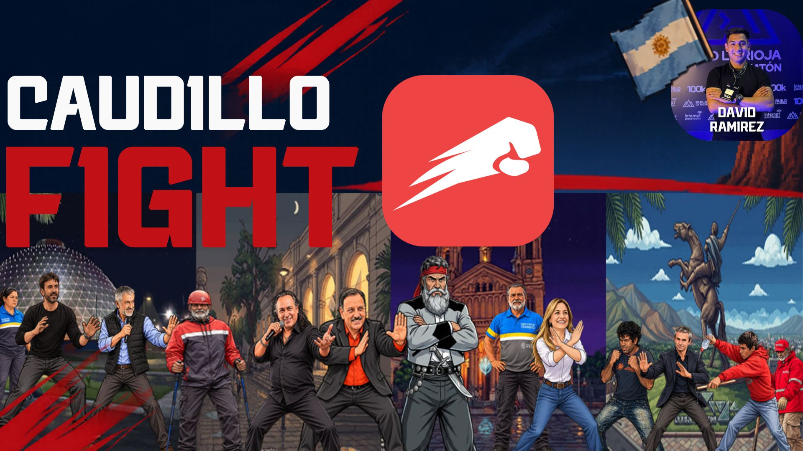 
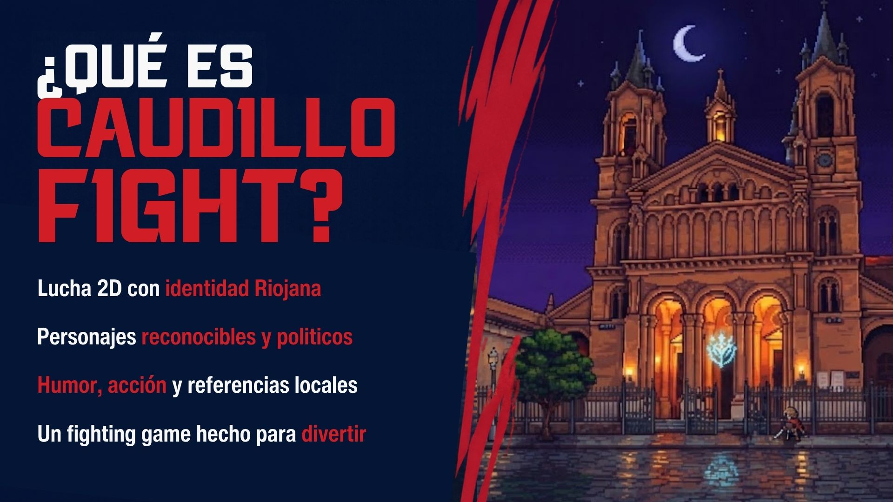 
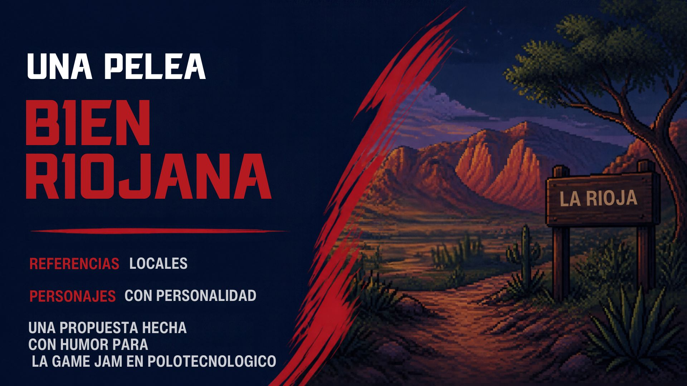 
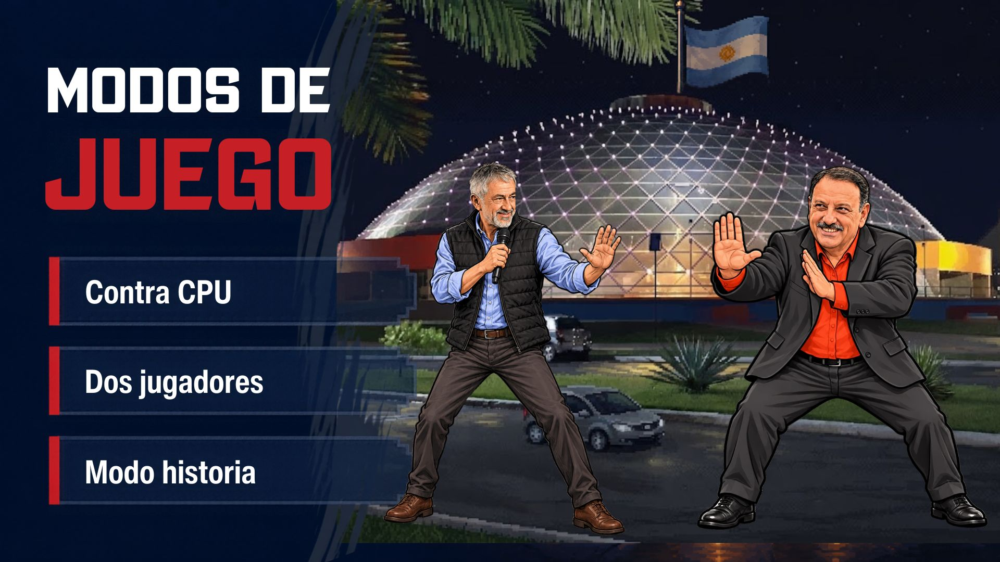 
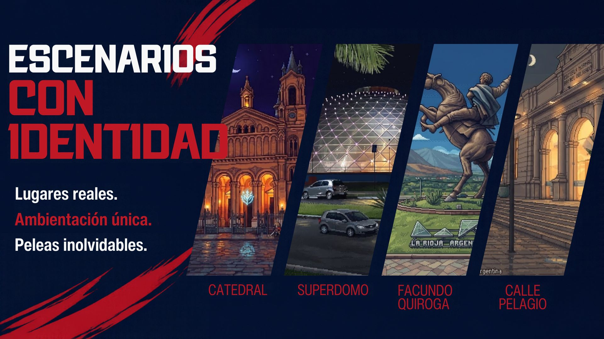 
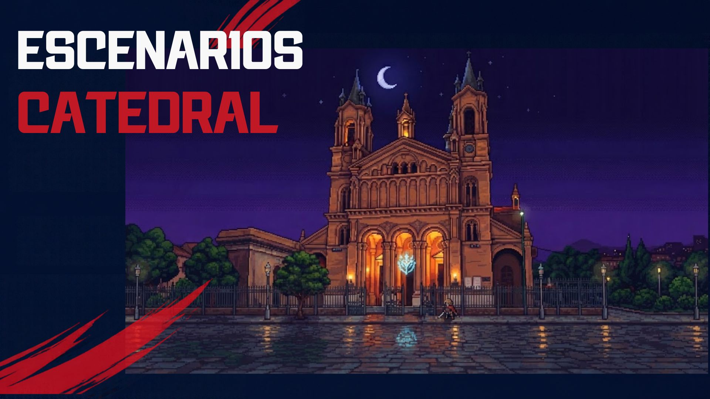 
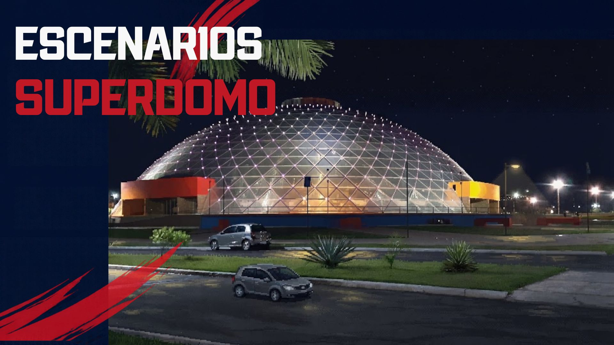 
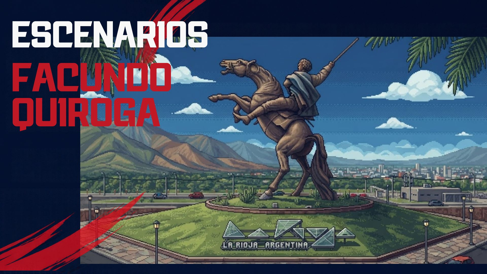 
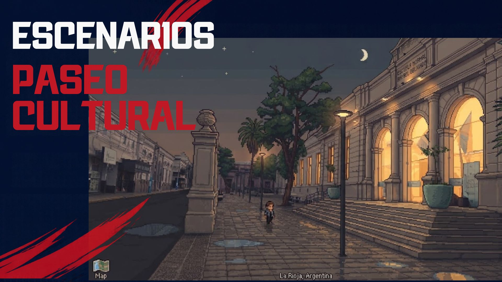 
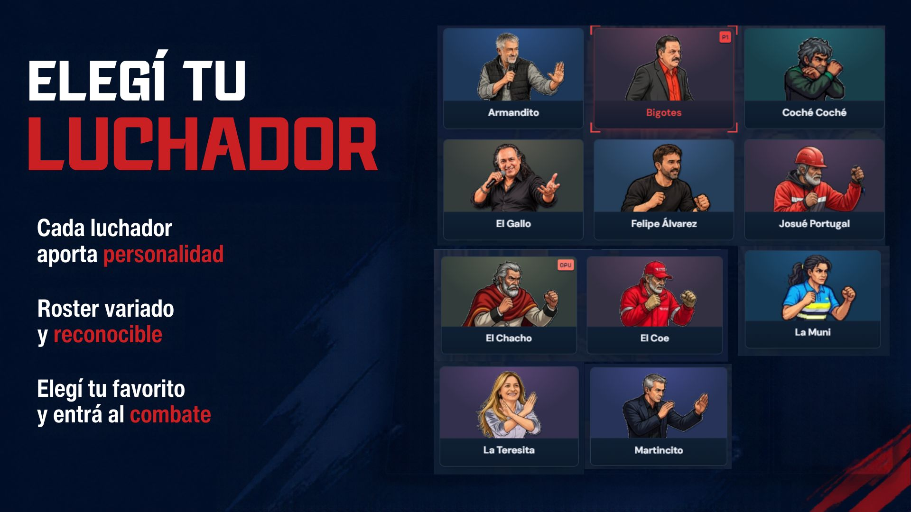 
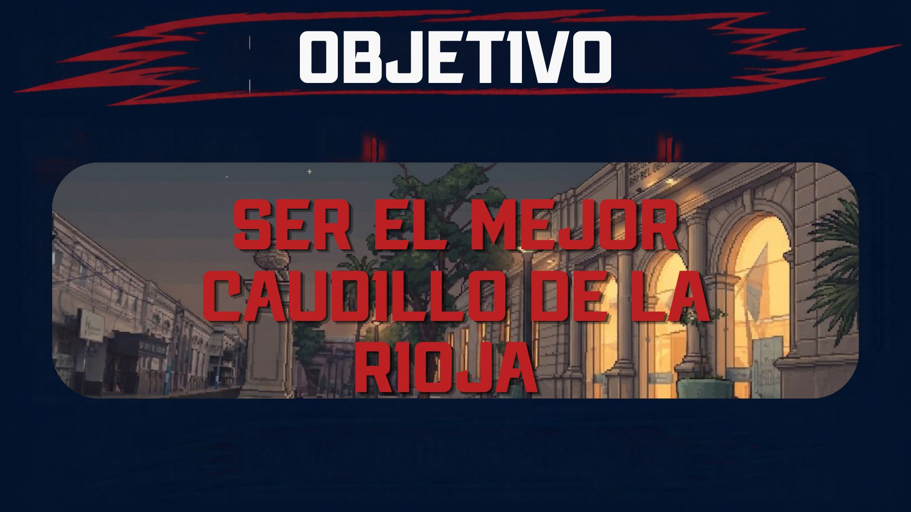 

## 🛠️ Tecnologías

- **Frontend:** React 19, TypeScript, HTML5 Canvas 2D para renderizado a 60 FPS, CSS animado.
- **Backend & Red:** Node.js, Express, WebSockets (`ws`) para sincronización determinista de estados y física entre jugadores.
- **Bundler & Tooling:** Vite, Sharp para compresión de texturas y fondos, TSX.

---

## 📜 Licencia y Créditos

- Adaptación, escenarios riojanos y producción artística desarrollada para la Game Jam por **chavow5**.
- Código base bajo licencia [GPL-3.0](LICENSE).
